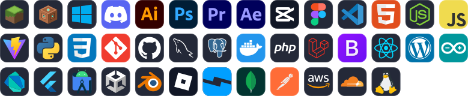

<!-- Generated by GitHub Profile Agent Console. Edit profile.config.json, then run npm run generate. -->

  <picture>
    <source media="(max-width: 760px) and (prefers-color-scheme: dark)" srcset="./assets/hero/agent-console-e2124e67-mobile-dark.svg">
    <source media="(max-width: 760px)" srcset="./assets/hero/agent-console-e2124e67-mobile-light.svg">
    <source media="(prefers-color-scheme: dark)" srcset="./assets/hero/agent-console-e2124e67-dark.svg">
    <source media="(prefers-color-scheme: light)" srcset="./assets/hero/agent-console-e2124e67-light.svg">
    
  </picture>

  Builderman

	
<a href="https://git.io/typing-svg">
  <picture>
    <source media="(prefers-color-scheme: dark)" srcset="https://readme-typing-svg.herokuapp.com?font=Fira+Code&size=28&duration=3000&pause=1000&color=00f0ff&center=true&vCenter=true&width=650&lines=Hello%2C+World!+I'm+Ayub!;Full+Stack+Developer;Web3+%26+Blockchain+Engineer;ML+%26+AI+Enthusiast;Cybersecurity+Expert;Moto+Unstoppable+Learner">
    <source media="(prefers-color-scheme: light)" srcset="https://readme-typing-svg.herokuapp.com?font=Fira+Code&size=28&duration=3000&pause=1000&color=006400&center=true&vCenter=true&width=650&lines=Hello%2C+World!+I'm+Ayub!;Full+Stack+Developer;Web3+%26+Blockchain+Engineer;ML+%26+AI+Enthusiast;Cybersecurity+Expert;Moto+Unstoppable+Learner">
    
  </picture>
</a>

---

## 📊 GitHub Activity Statistik

  <picture>
    <source media="(prefers-color-scheme: dark)" srcset="https://github-readme-streak-stats.herokuapp.com?user=imanuelayubflabianos&theme=dark&hide_border=false&border=21262d&background=0d1117&ring=e11d48&fire=e11d48&currStreakLabel=e11d48&sideNums=f1f5f9&currStreakNum=f1f5f9&sideLabels=94a3b8&dates=64748b&stroke=21262d">
    <source media="(prefers-color-scheme: light)" srcset="https://github-readme-streak-stats.herokuapp.com?user=imanuelayubflabianos&theme=default&hide_border=false&border=e4e2e2&background=ffffff&ring=be123c&fire=be123c&currStreakLabel=be123c&sideNums=0f172a&currStreakNum=0f172a&sideLabels=475569&dates=64748b&stroke=e2e8f0">
    
  </picture>

   

  <a href="https://github.com/vn7n24fzkq/github-profile-summary-cards">
    <picture>
      <source media="(prefers-color-scheme: dark)" srcset="https://github-profile-summary-cards.vercel.app/api/cards/profile-details?username=imanuelayubflabianos&theme=tokyonight">
      <source media="(prefers-color-scheme: light)" srcset="https://github-profile-summary-cards.vercel.app/api/cards/profile-details?username=imanuelayubflabianos&theme=default">
      
    </picture>
  </a>

   

  <a href="https://github.com/vn7n24fzkq/github-profile-summary-cards">
    <picture>
      <source media="(prefers-color-scheme: dark)" srcset="https://github-profile-summary-cards.vercel.app/api/cards/repos-per-language?username=imanuelayubflabianos&theme=tokyonight">
      <source media="(prefers-color-scheme: light)" srcset="https://github-profile-summary-cards.vercel.app/api/cards/repos-per-language?username=imanuelayubflabianos&theme=default">
      
    </picture>
  </a>
  <a href="https://github.com/vn7n24fzkq/github-profile-summary-cards">
    <picture>
      <source media="(prefers-color-scheme: dark)" srcset="https://github-profile-summary-cards.vercel.app/api/cards/most-commit-language?username=imanuelayubflabianos&theme=tokyonight">
      <source media="(prefers-color-scheme: light)" srcset="https://github-profile-summary-cards.vercel.app/api/cards/most-commit-language?username=imanuelayubflabianos&theme=default">
      
    </picture>
  </a>

   

  <a href="https://github.com/imanuelayubflabianos">
    <picture>
      <source media="(prefers-color-scheme: dark)" srcset="https://github-readme-stats-eight-theta.vercel.app/api?username=imanuelayubflabianos&show_icons=true&theme=github_dark&bg_color=0d1117&title_color=58a6ff&icon_color=58a6ff&text_color=c9d1d9&border_color=21262d&hide_border=false&count_private=true">
      <source media="(prefers-color-scheme: light)" srcset="https://github-readme-stats-eight-theta.vercel.app/api?username=imanuelayubflabianos&show_icons=true&theme=default&bg_color=ffffff&title_color=0969da&icon_color=0969da&text_color=24292f&border_color=e4e2e2&hide_border=false&count_private=true">
      
    </picture>
  </a>

---

### 🔗 Portofolio
> Let me introduce myself. 

  
  
  

---

## 🧑‍💻 About Me

<table>
<tr>
<td width="50%" valign="top">

### 🇮 Bahasa Indonesia

Halo! Saya **Imanuel Ayub Flabianos**, seorang **Fullstack Developer** dari Indonesia. Saya saat ini menempuh pendidikan di bidang **Pengembangan Perangkat Lunak dan Gim (PPLG/RPL)**.

Saya passionate dalam membangun aplikasi web dan sistem yang fungsional, efisien, dan memiliki tampilan yang menarik. Fokus utama saya meliputi pengembangan **Web & System (Fullstack)**, **IoT**, **UI/UX Design**, serta **Database Architecture**.

Saat ini saya terus **belajar dan membangun** proyek-proyek baru untuk mengasah kemampuan dan menambah pengalaman.

</td>
<td width="50%" valign="top">

### 🇧 English

Hello! I'm **Imanuel Ayub Flabianos**, a **Fullstack Developer** from Indonesia. I'm currently studying **Software & Game Development (PPLG/RPL)**.

I'm passionate about building functional, efficient, and visually appealing web applications and systems. My main focus areas include **Web & System Development (Fullstack)**, **IoT**, **UI/UX Design**, and **Database Architecture**.

I'm constantly **learning and building** new projects to sharpen my skills and gain experience.

</td>
</tr>
</table>

---

## 🛠️ Tech Stack &amp; Tools

<picture>
  <source media="(prefers-color-scheme: dark)" srcset="./assets/tech-stack-dark.svg">
  <source media="(prefers-color-scheme: light)" srcset="./assets/tech-stack-light.svg">
  
</picture>

<b>🛠️ Categorized Stack &amp; Tools</b>

 

| Category | Technologies &amp; Tools |
| :--- | :--- |
| **Languages** | `JavaScript` · `TypeScript` · `PHP` · `Python` · `Dart` · `HTML5` · `CSS3` |
| **Frameworks & Libs** | `Laravel` · `React` · `Node.js` · `Vite` · `Flutter` · `Bootstrap` · `WordPress` · `Arduino` |
| **Databases & DevOps** | `MySQL` · `PostgreSQL` · `MongoDB` · `Docker` · `AWS` · `Cloudflare` · `Linux` · `Windows` |
| **Tools & Creative** | `Minecraft` · `Command Block` · `Roblox` · `Roblox Studio` · `VS Code` · `Android Studio` · `Git` · `GitHub` · `Postman` · `Figma` · `Photoshop` · `Illustrator` · `Premiere` · `After Effects` · `CapCut` · `Unity` · `Blender` · `Discord` |

---

## 📈 Engineering Focus

[Game Development] ──► Make and Develop more Games.  
[Web Applications] ──► Building scalable backends with Laravel &amp; PHP.  
[Database Systems] ──► Designing efficient MySQL schema &amp; queries.  
[User Interface]   ──► Creating clean layouts via Figma &amp; Bootstrap.  
[IoT &amp; Systems]    ──► Exploring device-to-cloud integration.  

	
---

### My Absolute Favorites:

- 💻 &nbsp; I love exploring new tech stack and building cool stuffs, and playing Music
- 📰 &nbsp; Reading &amp; writing tech blogs whenever possible.
- 🍕 &nbsp; Meetups &amp; Tech events.

	
   
  
<b>⚙️ Things I use to get stuff done</b>

  <ul>
    <li><b>OS:</b> Windows, Linux </li>
    <li><b>Laptop:</b> Advan Workpro Lite (Intel Core i3 12th Gen)</li>
    <li><b>Code Editor:</b> VS Code - The best editor out there.</li>
    <li><b>Stay Updated:</b> LinkedIn, GitHub, and more.</li>
  </ul>	

---

### 📬 Connect &amp; Collaborate

	  
  
  &nbsp;
  
  &nbsp;
  
  &nbsp;

---

  Built with ❤️ by <b>Imanuel Ayub Flabianos</b> | © 2026

  

---
